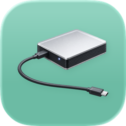
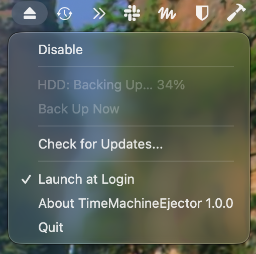

# TimeMachineEjector

A simple Mac menu bar app that automatically ejects your Time Machine backup disk when a backup finishes.

If you leave an external backup disk connected, you have to remember to eject it before unplugging. TimeMachineEjector watches Time Machine and ejects the disk once the backup and its cleanup are done, so you can unplug it any time.

No more of this:

The disk stays connected while ejected. Choose **Back Up Now** from the menu bar to mount it and start a backup; it is ejected again when the backup finishes.

## Requirements

macOS 13 or later.

## Usage

Download the latest pre-built application binary from Releases page.

## Development

- `./scripts/install.sh` builds a Release build and replaces `/Applications/TimeMachineEjector.app` with it (`--no-launch` to skip launching).
- `./scripts/release.sh <version> [--notes <file>]` bumps the version, builds a zip, updates `appcast.xml`, and publishes a GitHub Release. Use `--no-publish` to stop before committing.
