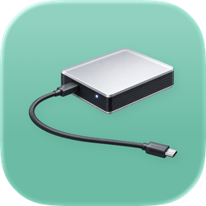
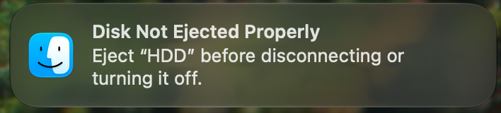
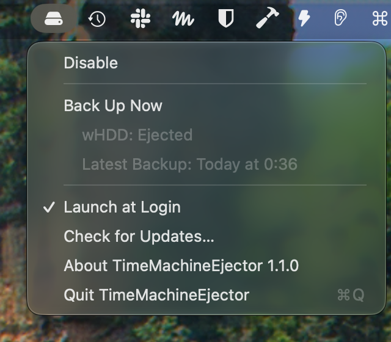

# TimeMachineEjector



A simple Mac menu bar app that automatically ejects your Time Machine backup disk when a backup finishes.

If you leave an external backup disk connected, you have to remember to eject it before unplugging. TimeMachineEjector watches Time Machine and ejects the disk once the backup and its cleanup are done, so you can unplug it any time.

**[Download the latest version](https://github.com/wata/TimeMachineEjector/releases/latest)** — signed and notarized, with automatic updates.

No more of this:



The disk stays connected while ejected. Scheduled backups keep running on Time Machine's own schedule: when a backup is due, TimeMachineEjector mounts the disk and starts it. You can also choose **Back Up Now** from the menu bar. Either way, the disk is ejected again when the backup finishes.



## Features

- **Ejects after the backup is really done**: it waits until Time Machine reports it is no longer running, so the cleanup after the copy isn't cut short.
- **Scheduled backups keep running**: Time Machine doesn't mount an ejected disk by itself, so TimeMachineEjector mounts it when a backup is due, following the frequency set in Time Machine settings. Nothing happens if automatic backups are off.
- **Back Up Now from the menu bar**: mounts the ejected disk and starts a backup.
- **Status at a glance**: the menu shows whether the disk is connected, ejected, or backing up, with progress, and when the latest backup was. The menu bar icon (a disk) gets a Time Machine badge while a backup is running, so you can tell when not to unplug the disk.
- **Disable** it from the menu when you want to keep the disk mounted.
- Launch at Login, and automatic updates.

## Requirements

macOS 13 or later.

## Usage

Download the latest pre-built application binary from Releases page and move it to `/Applications`. TimeMachineEjector checks for updates automatically, and you can also choose Check for Updates… from its menu.

Or install it with [Homebrew](https://brew.sh):

```sh
brew install --cask wata/tap/timemachineejector
```

Open it once and turn on Launch at Login from the menu bar icon. There is nothing else to set up; it works with the backup disk you already use in Time Machine.

The disk is unmounted, not powered off, so it can be mounted again for the next backup. Other volumes on the same disk are unmounted too, just like ejecting it in Finder.

### When can I unplug the disk?

Any time the menu shows **Ejected**. While the menu bar icon has a Time Machine badge, a backup is running, so wait until it shows Ejected.

## Development

- `./scripts/install.sh` builds a Release build and replaces `/Applications/TimeMachineEjector.app` with it (`--no-launch` to skip launching).
- `./scripts/release.sh <version> [--notes <file>]` bumps the version, builds a zip, updates `appcast.xml`, and publishes a GitHub Release. Use `--no-publish` to stop before committing.

## License

MIT
